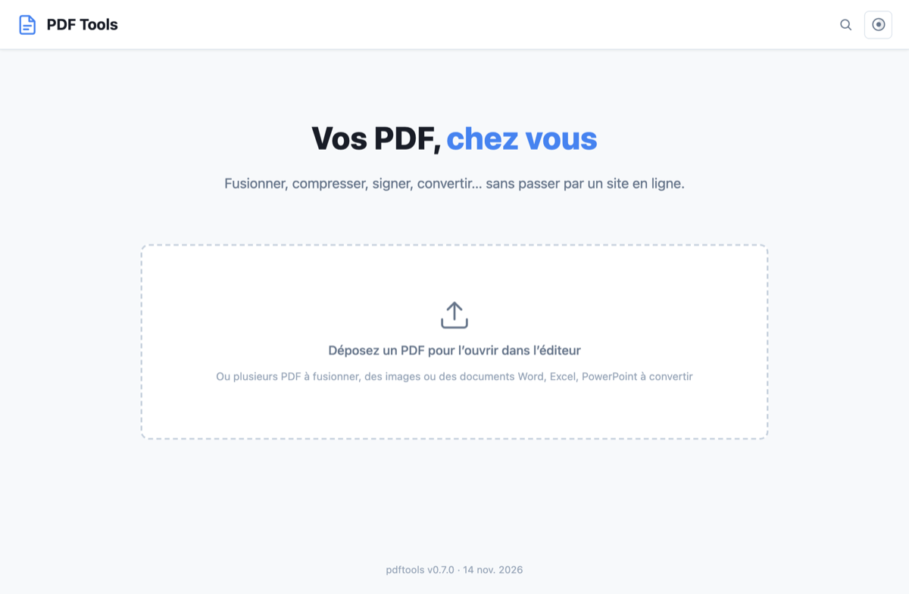

  

<h1 align="center">PDF Tools</h1>

  <strong>Vos PDF, chez vous.</strong> 
  Fusionner, signer, convertir, caviarder… sans envoyer vos documents sur un site en ligne.

  <a href="../../releases/latest"><strong>Télécharger la dernière version →</strong></a>

  

---

## Ce que l’application sait faire

**21 outils**, tous exécutés **sur votre ordinateur**. Déposez un PDF : il s’ouvre dans
l’éditeur, et chaque outil ajoute une version qu’on peut défaire.

| | |
|---|---|
| **Organiser** | Fusionner plusieurs PDF · Diviser par plages ou toutes les N pages · Supprimer des pages · En extraire · Réorganiser par glisser-déposer · Pivoter |
| **Convertir** | Images (JPG, PNG, HEIC…) → PDF · PDF → images · PDF → texte |
| **Modifier** | **Signer** (signature dessinée, tapée ou photographiée, posée sur une page ou sur toutes) · Annoter (texte, surlignage, formes, dessin, notes) · Corriger le texte déjà présent · Remplir un formulaire · Numéroter les pages · Filigrane · Rogner · Métadonnées |
| **Sécurité** | Protéger par mot de passe (AES-256) · Déverrouiller · **Caviarder** (le texte est retiré, pas masqué) · Comparer deux versions |

  

## Vos documents ne sortent pas de l’ordinateur

C’est la raison d’être de l’application, pas un effet de bord :

- **aucun envoi, nulle part** — ni serveur, ni « cloud », ni service tiers. L’application
  refuse d’elle-même toute requête qui ne va pas vers son propre moteur local ;
- **aucun compte**, aucune inscription, aucune publicité, aucune mesure d’audience ;
- rien n’est conservé à votre insu : le document que vous travaillez reste dans
  l’application, et disparaît quand vous le fermez.

La seule chose que l’application demande à Internet, c’est le **numéro de la dernière
version publiée ici** — pour vous proposer la mise à jour. Aucun document, aucun nom de
fichier n’accompagne cette question.

## Installer

Prenez le fichier qui correspond à votre machine dans la
[dernière version](../../releases/latest) :

| Système | Fichier |
|---|---|
| **Windows** | `pdftools-<version>-setup.exe` |
| **macOS** (puces Apple) | `pdftools-<version>-arm64.dmg` |

L’application n’est pas signée — un certificat d’éditeur coûte quelques centaines d’euros
par an, et c’est un outil de famille. Votre système vous préviendra donc une fois :

- **Windows** : « Windows a protégé votre ordinateur » → *Informations complémentaires* →
  *Exécuter quand même* ;
- **macOS** : clic droit sur l’application → *Ouvrir* → *Ouvrir* (au premier lancement
  seulement).

Aucun droit administrateur n’est nécessaire.

## Les mises à jour

L’application regarde au démarrage s’il existe une version plus récente ici, la télécharge
en arrière-plan, puis affiche un bandeau : **« Version X prête à installer »**. Un clic, elle
redémarre à jour. Rien à surveiller.

## Questions

**Faut-il être connecté à Internet ?** Non. Tout fonctionne hors ligne ; seule la
vérification de mise à jour a besoin du réseau, et son échec ne gêne rien.

**Et mes gros fichiers ?** Tout se passe en mémoire sur votre machine : un PDF de 500 pages
reste manipulable, et rien ne transite.

---

Ce dépôt ne contient que les applications prêtes à installer : aucun code source. 
Il est public pour que l’application puisse vérifier ses mises à jour sans jeton d’accès.

